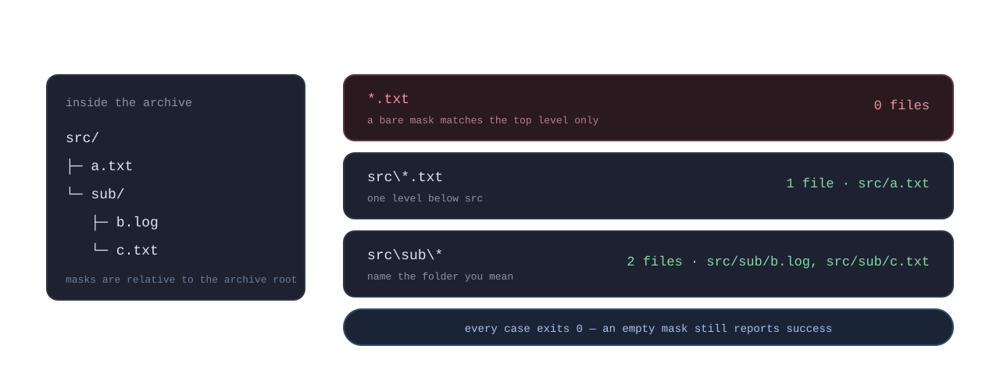

# Bandizip archives: packing and unpacking through bz.exe


> **Terminology**
> - **Arguments** are passed by the agent on every call and declared in the tool schema, such as `level`, `overwrite`, `include`, and `timeoutSeconds`.
> - **Settings** are configured by you on the plugin page and apply across calls, usually permissions or environment, such as `allowArchiveOverwrite`, `restrictToWorkspace`, `allowPassword`, `bzPath`, `maxExtractBytes`, `rejectSymlinkEntries`, and `timeoutSeconds` (as a cap).
> - **Command-line switches** belong to `bz.exe` itself, such as `-aoa`, `-o:`, and `-r-`; do not confuse them with the other two.

## What it solves

An agent handling archives could compose a `bz.exe` command line itself, but the
command-line switches carry traps: `-o:` must precede the archive, `x` and `e`
differ in whether the directory structure survives, a missing overwrite
command-line switch (`-ao*`) parks the process on an interactive prompt, and exit
code 1 can mean either a warning or a failure. This plugin folds those details into one tool, so the agent only has to
say what it wants.

## The eight actions

| action | Does | Key arguments |
|---|---|---|
| `create` | Build a new archive | `files`, `format`, `level`, `include` (glob), `mode` (`create` / `append`), `password` |
| `extract` | Unpack into a folder, after three pre-write guards | `destination`, `include` / `exclude` (archive masks), `overwrite`, `flat`, `dryRun` |
| `list` | List entries, filtered and paged | `filter`, `limit`, `offset`, `encoding` |
| `test` | Verify entry data and passwords with `bz t` | `password` |
| `preview` | Inspect without extracting, aggregate view | the `list` arguments |
| `diff` | Compare two archives | `archive2` |
| `browse` | Walk the archive one level at a time | `path`, `depth` |
| `convert` | Repack into another format, level or password | `format`, `level`, `password`, `newPassword`, `deleteSource` |

## How masks match

An `include` / `exclude` mask is a path relative to the archive root, and `*`
covers exactly one level. All three cases below report success — including the
one that matches nothing. **The plugin only reads bz's exit code and does not
detect an empty match for you, so check the returned entry count yourself:**



## Examples

Inspect an archive without writing anything:

```json
{"action": "preview", "archive": "release.zip"}
```

Extract only the subset you need (masks are relative to the archive root and use
backslashes):

```json
{"action": "extract", "archive": "assets.zip", "destination": "out", "include": ["assets\\scene\\*.js"]}
```

See what a real extract would collide with before running it:

```json
{"action": "extract", "archive": "assets.zip", "destination": "out", "dryRun": true}
```

Pack by glob and verify the result:

```json
{"action": "create", "archive": "src.zip", "files": ["."], "include": ["**/*.ts"], "verify": true}
```

Compare two releases:

```json
{"action": "diff", "archive": "v1.zip", "archive2": "v2.zip"}
```

## Every behaviour is decided per call

### Arguments versus settings

The "Default" column below is the schema default an **argument** takes when the
call omits it; the agent supplies or omits it on each call. **Settings**, by
contrast, are configured by you on the plugin page and apply across calls
(permissions and environment such as `allowArchiveOverwrite`,
`restrictToWorkspace`, `allowPassword`, and `bzPath`). Changing an argument
affects only that call; changing a setting affects every later call. Pass another
value when the task needs one:

| Argument | Default |
|---|---|
| `level` | `5` (0 stores only, 9 is smallest) |
| `recursive` | `true` |
| `overwrite` | `overwrite` (replace same-named files on extract) |
| `flat` | `false` (keep the directory structure) |
| `destination` | a folder beside the archive, named after it |
| `volumeSize` | none (no splitting) |
| `mode` | `create` |
| `encoding` | `auto` (fall back from UTF-8 to GBK) |
| `timeoutSeconds` | this is an **argument**: it defaults to the `timeoutSeconds` setting (schema default 900 s); a per-call value takes priority |

## Safety and boundaries

- **Passwords travel as command-line switches**, so other processes on this
  machine can read them in the process list. Turn `allowPassword` off on the
  plugin page when the capability is not needed.
- **create never replaces an existing archive** unless two gates both open:
  `allowArchiveOverwrite` must be on, and the call must pass
  `overwrite: "overwrite"` explicitly.
- **`restrictToWorkspace`** confines `archive`, `files` and `destination` to the
  session working directory.
- **Three guards run before extract writes anything.** Each returns `ok:false` with
  `rejected:true`, and any one failure rejects the whole archive:
  - **zip-slip**: an entry naming `..`, an absolute path or a drive letter is
    rejected and the offending entry is reported.
  - **compressed-bomb ceiling** (`maxExtractBytes`): the extracted sizes the entries
    *declare* are summed, and the archive is rejected when the total exceeds the
    ceiling; `0` disables the check. Those sizes come from the archive's own
    headers, so a hostile archive can understate them — this is a cheap early stop,
    not proof.
  - **symlink entries** (`rejectSymlinkEntries`, on by default): a symlink can
    redirect later writes outside the destination. `bz l`'s attribute column carries
    only the directory flag and the DOS archive bit, so a symlink entry prints
    exactly like a regular file; the plugin therefore reads the Unix mode bits in
    the ZIP central directory itself. **Only zip / zipx are covered** — 7z, tar and
    other formats, plus ZIP64 central directories, are not scanned, and there the
    setting does not apply rather than "confirmed clean".
- **`dryRun` also sits behind those three guards**: it runs after them, so it too
  rejects the archive on a path escape, an over-budget total or a symlink entry.
- **`convert` needs double the disk**: it unpacks into a temporary directory and
  repacks, so check free space for large archives.

## Known limits

- **`diff` compares name and size only** — a change that keeps the size is
  invisible, and the output says so.
- **Encrypted archives cannot be listed** unless a `password` is supplied: a 7z
  archive asks for the password at the `list` stage, so `preview` and `diff` have no
  data to work on without one.
- **No repair, no mounting**: `bz.exe` is a console compressor, so a damaged
  archive can only be salvaged, and mounting belongs to the GUI product.
- **The symlink guard covers zip / zipx only**: `bz l` does not report entry types
  for 7z, tar and other formats, and this plugin does not guess; ZIP64 central
  directories are skipped as well. In those cases `rejectSymlinkEntries` does not
  apply — do not read its silence as "confirmed no symlinks".
- **Relative paths resolve against the session working directory**, not the
  plugin directory.

## How this differs from comparable projects

Archive tooling splits into two camps: built for agents, and built for people.

The DSH ecosystem already has an agent-facing archive plugin — `yuehancn/dsh-tool-archive`: four tools (`archive_pack`, `archive_unpack`, `archive_status`, `archive_verify`), a tar format it reads and writes itself, no external dependency, deterministic packing, a per-member refusal to write outside the destination, and SHA-256 verification of what came out. On the MCP side there is `zipnative-mcp` (a dozen typed tools, traversal/symlink/bomb guards on by default) and `zv-louis/mcp7zop` (a wrapper around a local 7-Zip CLI).

What those share is an **engine of their own** — either implementing the format or shipping a compression stack. This plugin takes the other road: **no new engine; it connects the Bandizip already installed on the machine to the agent's tool surface.**

| | `dsh-tool-archive` | This plugin |
|---|---|---|
| Engine | tar, implemented in the plugin | the local `bz.exe` |
| Formats | tar | zip / zipx / 7z / iso / exe / lzh / tar family |
| Determinism, checksum | a strength (deterministic tar + SHA-256) | none (integrity via `bz t`) |
| Runtime | zero dependency, cross-platform | Windows + Bandizip installed |
| Tool shape | 4 tools | 1 tool with 8 actions |

The remaining points are differences against the MCP group:

1. **One tool with eight actions, not one tool per action.** Most sampled projects stop at create / list / extract and tend to register a separate tool for each. Here a single `bandizip` dispatches on `action`, so the tool list grows by one line.
2. **Settings keep only permissions, environment facts and ceilings.** None of the nine is a behaviour preference such as a default compression level — level, recursive, overwrite, flat, mode, encoding and destination are all passed per call. What remains answers three questions: what may be used, what it points at, and the hard ceilings.
3. **Three guards before anything is written.** zip-slip, a declared-size ceiling and symlink entries; failing any one refuses the whole archive. **These are not unique to this plugin** — `zipnative-mcp` and `dsh-tool-archive` have guards of their own — the difference is that here they sit in front of one machine's multi-format engine.
4. **`diff` and `convert` were not found among comparable projects in the sample.** Both are ordinary actions here: `diff` states plainly that it compares by name and size only, and `convert` verifies the result with `bz t` and deletes the source only after success.

> Sampling note: "not found" means not found in this round of sampling (project pages were checked for existence; CVE / GHSA identifiers were not verified one by one). Comparisons age; read this as an observation at the time of writing.

