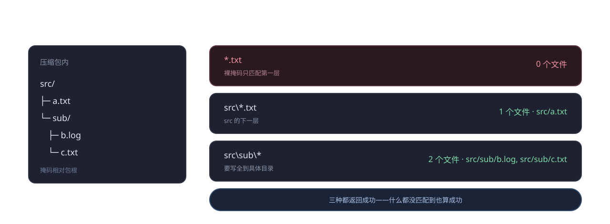

# Bandizip 压缩包：把打包和解包交给 bz.exe


> **术语说明**
> - **参数**：智能体每次调用传的，写在工具 schema 里，如 `level`、`overwrite`、`include`、`timeoutSeconds`。
> - **设置**：你在插件页配的，跨调用生效，多为限权或环境，如 `allowArchiveOverwrite`、`restrictToWorkspace`、`allowPassword`、`bzPath`、`maxExtractBytes`、`rejectSymlinkEntries`、`timeoutSeconds`（作为上限）。
> - **命令行开关**：`bz.exe` 自己的开关，如 `-aoa`、`-o:`、`-r-`，不要与前两者混称。

## 它解决什么问题

智能体要处理压缩包时，最省事的做法是让它自己拼 `bz.exe` 的命令行——但 `bz` 的命令行开关有坑：`-o:` 必须放在压缩包之前、`x` 和 `e` 决定要不要保留目录结构、缺了覆盖命令行开关（`-ao*`）会停在交互提示上、退出码 1 既可能是警告也可能是失败。这个插件把这些细节收进工具里，让智能体只需要说清「做什么」。

0.3.0 起不再是一个工具带 `action` 枚举，而是 **9 个语义化工具**：每个工具的参数只声明它自己用得到的，输出也各有一套 schema。

## 九个工具

| 工具 | 干什么 | 关键参数 |
|---|---|---|
| `list_archive` | 列出条目；顺带回答「是否加密」「是否分卷」 | `filter`、`limit` / `offset`、`encoding`、`stats`、`password` |
| `extract_archive` | 解压到目录；写盘前过三道防线 | `destination`、`overwrite`（必填）、`include` / `exclude`、`dryRun`、`symlinks`、`checksum`、`flat` |
| `create_archive` | 打包 / 追加 / 分卷 / 加密 | `files`、`format`、`level`、`include` / `exclude`、`mode`、`volumeSize`、`verify`、`recursive` |
| `compress_file` | 单文件压成 gz / xz / zstd | `file`、`format`、`level`、`destination`、`overwrite` |
| `decompress_file` | 把 gz / xz / zstd 解回文件 | `file`、`format`（可省）、`destination`、`overwrite` |
| `check_archive` | 用 `bz t` 逐条校验数据段与密码 | `password`、`checksum` |
| `detect_format` | 按**魔数**识别格式 | `path` |
| `diff_archive` | 比较两个包 | `archive2`、`filter`（子串或 glob） |
| `convert_archive` | 换格式 / 换级别 / 改密码 | `format`、`level`、`password`、`newPassword`、`deleteSource`、`destination` |

### 格式识别（`detect_format`）

旧版按扩展名推断，推不出就报错——改过名的包、下载下来没后缀的包都会踩到。现在按**魔数**：

| 格式 | 判定位置 |
|---|---|
| ZIP | 偏移 0：`50 4B 03 04` / `05 06` / `07 08` |
| 7z | 偏移 0：`37 7A BC AF 27 1C` |
| RAR | 偏移 0：`52 61 72 21 1A 07` |
| GZIP | 偏移 0：`1F 8B` |
| XZ | 偏移 0：`FD 37 7A 58 5A 00` |
| BZIP2 | 偏移 0：`42 5A 68` |
| ZSTD | 偏移 0：`28 B5 2F FD` |
| LZH | 偏移 2：`-lh`（LZH 没有前导签名） |
| TAR | 偏移 257：`ustar` |
| ISO | 偏移 0x8001：`CD001` |
| CAB | 偏移 0：`MSCF` |
| 自解压 exe | 偏移 0：`MZ` |

认不出时依次回退：跑 `bz l` 解析 `Archive format:` 行 → 扩展名（此时 `isArchive: false`，因为字节没背书）→ 全不中就报 `format: "unknown"`，这是**答案**而不是错误。

### 加密检测（`list_archive` / `detect_format`）

`bz l` 不标注加密：实测用 `-p:123` 建的加密 zip，Attr 仍是 `A___`。所以分格式处理：

- **ZIP / ZIPX**：插件自己的中央目录解析器读 General Purpose Bit Flag 的 **bit 0**，能给出「加密条目数」。
- **7z / RAR / LZH / CAB**：不做深度解析，用试探法——**无密码跑一次 `bz t`**，报密码错就是加密，干净通过就是没加密。每次试探是一整趟读取，所以按「路径 + 大小 + mtime」缓存。
- **tar 与 gz/xz/bzip2/zstd/iso**：没有加密概念，直接 `false`。
- **探测失败不抛错**：返回 `encrypted: 'unknown'`，判定来源（`zip-central-directory` / `bz-test-trial` / `format-cannot-encrypt`）与具体原因都写在 `note` 里。

### 分卷（`list_archive`）

ZIP 分卷在磁盘上表现为兄弟文件：`xxx.z01`、`xxx.z02`… 加最后一个 `xxx.zip`。`.zip` 本身看不出自己只是一片，所以按兄弟文件数判断，`parts` 含 `.zip` 本身。

### 三种视角：列举、统计、扁平化

- **`list_archive` 的 `stats:true`** 给三项聚合：`byExtension`（扩展名 → `{ count, bytes }`）、`topLevelDirs`（顶层名字 → `{ entryCount, uncompressedBytes }`）、`largest`（前 10 个 `name` + `size`）。全部从已解析的 entries 计算，不多跑一次 `bz`。**口径是整个包**：传了 `limit` / `offset` / `filter` 也不会让聚合只描述这一页。
- **`extract_archive` 的 `flat:true`** 用 `e` 而非 `x`，所有文件直接落到目标目录，`entries[].landed` 同步变成裸文件名。与 `include` / `exclude` 组合时逐条目解压也切到 `e`；符号链接预检不受影响——变的只是解压命令。
- **`create_archive` 的 `recursive:false`** 只打包顶层文件（`-r-` 加 `dir/*`），不含顶层文件的目录（包括只装着空子目录的目录）跳过并在 `note` 里点名，全为空则报错。它**不能**与 `include` / `exclude` 同用：两者选文件的口径不同，插件选择报错而不是替你排优先级。

## 掩码怎么匹配

`include` / `exclude` 的掩码是**相对包根的路径**，`*` 只代表一层。三种情况都会返回成功——包括一条都没匹配到的那种。**插件只看 bz 的退出码，不会替你检测「空匹配」，请自己核对返回的条目数**：



## 典型用法

只看包里有什么，不落地：

```json
{"archive": "release.zip", "filter": "src/"}
```

只解出需要的子集（掩码相对包根，用反斜杠）：

```json
{"archive": "assets.zip", "destination": "out", "overwrite": "overwrite", "include": ["assets\\\\scene\\\\*.js"]}
```

先把冲突摸清楚再动手：

```json
{"archive": "assets.zip", "destination": "out", "overwrite": "skip", "dryRun": true}
```

打包时按通配筛选，并在完成后自检：

```json
{"archive": "src.zip", "files": ["."], "include": ["**/*.ts"], "verify": "roundtrip"}
```

压一个日志文件（zstd 需要 Node ≥ 22.15）：

```json
{"file": "access.log", "format": "zstd", "level": 9}
```

比较两版包的差异：

```json
{"archive": "v1.zip", "archive2": "v2.zip"}
```

## 行为都在调用时决定

### 参数与设置的区别

下表的「缺省」是**工具参数**在调用未指定时采用的 schema 缺省值，由智能体每次调用按情况传入或省略；而**设置**是你在插件页配置的、跨调用生效的限权与环境项（如 `allowArchiveOverwrite`、`restrictToWorkspace`、`allowPassword`、`bzPath`）。两者不同：改参数只影响这一次调用，改设置影响之后的每一次调用。需要别的取值就当场传参：

| 参数 | 缺省 |
|---|---|
| `level` | `5`（0 只打包不压缩，9 体积最小） |
| `overwrite`（extract） | **无缺省**：`overwrite` / `skip` / `rename` 必须显式给 |
| `overwrite`（create / convert） | 无：只接受 `"overwrite"` 时才允许替换已有包 |
| `overwrite`（compress / decompress） | `false`（已存在的输出文件不覆盖） |
| `destination`（extract） | **无缺省**：必须显式给落地目录 |
| `destination`（compress / decompress / convert） | 由源文件名推导 |
| `mode` | `create` |
| `recursive` | `true`（`false` 只打包顶层文件） |
| `flat` | `false`（保留目录结构） |
| `stats` | `false`（`true` 时额外返回三项聚合） |
| `symlinks` | 取设置 `rejectSymlinkEntries`（缺省 `true` → `reject`） |
| `volumeSize` | 无（不分卷） |
| `encoding` | `auto`（UTF-8 失败回退 GBK） |
| `timeoutSeconds` | 这是**参数**：缺省取设置里的 `timeoutSeconds`（缺省值 900 秒）；本次调用传入时优先 |

### 参数作用域是硬边界

宿主不会拿 `parameters` 校验实参，所以每个工具的 `execute` 会先检查参数名与必填项：传了不属于该工具的字段（比如给 `list_archive` 传 `dryRun`）会直接报错，并列出该工具真正接受的名单；漏掉必填参数（比如 `extract_archive` 的 `destination`）也会当场报错，而不是退化成 `<cwd>/undefined` 这种看起来成功的调用。同理，参数对象声明了 `additionalProperties: false`，schema 层面也不接受多余字段。

## 安全与边界

- **密码走命令行**：以 `bz.exe` 参数形式传递，本机其它进程可以在进程列表里看到。不需要密码能力时，在插件页关闭 `allowPassword`。
- **create / convert 不覆盖同名包**：两道闸门——`allowArchiveOverwrite` 关闭时一律拒绝；即使开启，也必须显式传 `overwrite: "overwrite"`。
- **`restrictToWorkspace`**：开启后 `archive` / `files` / `destination` 都被限制在会话工作区内。
- **解压前的三道防线**：`extract_archive` 在写盘之前依次检查，任一不过就整包拒绝（返回 `ok:false` 与 `rejected:true`）：
  - **zip-slip**：条目里出现 `..`、绝对路径或盘符时拒绝，并报出问题条目名。
  - **压缩炸弹上限**（设置 `maxExtractBytes`）：把各条目**声明**的解压后大小相加，超过上限就拒绝；`0` 表示不检查。这个尺寸来自压缩包自己的声明，异常包可能谎报，所以它是早期止损而不是证明。
  - **符号链接条目**（`symlinks` 参数，缺省跟随设置 `rejectSymlinkEntries`）：符号链接可以把后续写入引出目标目录。`bz l` 的属性列只带目录标志和 DOS 归档位，符号链接条目打印出来和普通文件一样，所以插件改为直接读 **ZIP 中央目录的 Unix 模式位**、以及 **tar 头的 typeflag `'2'`**。**7z 等格式不在覆盖范围内**，此时这项不起作用而不是「已确认干净」。三种策略：`reject` 整包拒绝、`skip` 只丢链接条目（其余照解）、`allow` 原样放行。
- **`checksum` 可以在解压前拦住错包**：`extract_archive` 给了 `checksum` 时先核对压缩包本身的摘要，不匹配直接拒绝，一个字节都不写。
- **`dryRun` 也走上面三道检查**：`dryRun` 分支排在这些检查之后，所以它同样会因路径穿越、超限或符号链接而拒绝整包。
- **`convert_archive` 要双倍磁盘**：实现方式是解压到临时目录再重新打包，大包请先确认空间。

## 已知限制

- **`diff_archive` 只能按「名字 + 大小」比较**：同大小但内容不同的改动检测不到，输出里会明确写这一点。
- **加密封包列不出条目**：7z 加密包在列举阶段就要求密码，此时 `list_archive` 返回 `ok:false`（`note` 会说明是加密导致），给了 `password` 才能列。
- **没有修复和挂载**：`bz.exe` 是纯命令行压缩器，没有 repair、也没有挂载能力；损坏的包只能尽量解出可解的部分。
- **符号链接检查只覆盖 zip / zipx / tar**：7z 等格式的条目类型不在 `bz l` 的输出里，插件不做猜测；ZIP64 中央目录与超过 4 MB 的中央目录也跳过扫描。这些情况下检查不生效，不要把它理解为「已确认无符号链接」。
- **ZIP 中央目录解析读的是整块结构**：加了 4 MB 上限（`maxCentralDirectoryBytes` 的等价常量），超限就跳过加密 / 符号链接探测并在 `note` 里说明。
- **编译型格式的加密判定是试探**：7z / RAR 的「无密码 `bz t`」如果既没提密码又失败了（比如包本身损坏），结果是 `'unknown'` 而不是猜一个。
- **gzip 载荷靠名字区分 tgz**：`1F 8B` 只说「这是 gzip」，文件名以 `.tar.gz` / `.tgz` 结尾时才报 `tgz`。
- **相对路径以会话工作目录为基准**，不是插件目录。

## 从 0.2.x 迁移

0.3.0 是**破坏性变更**：所有 `bandizip {action: …}` 调用失效，没有兼容入口。完整对照表在 README 的「从 0.2.x 迁移」一节；最容易踩的几处是：

- `extract` → `extract_archive`，且 `destination` 与 `overwrite` 变成**必填**。
- `preview` / `browse` 两个 action 取消：前者用 `list_archive` 的 `entries` 自行统计，后者用 `list_archive` + `filter` 做前缀筛选。
- `create` 的 `recursive` 取消，打包恒为递归；`create` 的 `encoding` 取消（它不解析条目名）。
- 单文件压缩从「`create -fmt:gz`」变成 `compress_file` / `decompress_file`，并**新增 zstd**。
- 格式识别从「按扩展名、推不出就报错」变成 `detect_format` **按魔数**识别。

## 与同类的差异

压缩包工具可以分成两拨：给智能体用的，和给人用的。

DSH 生态里已经有一个面向智能体的压缩包插件——`yuehancn/dsh-tool-archive`：注册 `archive_pack` / `archive_unpack` / `archive_status` / `archive_verify` 四个工具，tar 格式自己读自己写、零外部依赖，确定性打包，解包时逐个成员拒绝写到目标目录之外，并用 SHA-256 核对解出来的东西。MCP 侧另有 `zipnative-mcp`（十几个 typed tool，默认开启 traversal / symlink / bomb 防护）与 `zv-louis/mcp7zop`（包一层本地 7-Zip 命令行）。

这些项目的共同点是**自带引擎**：要么自己实现格式，要么随包分发一套压缩能力。本插件走的是另一条路——**不新增引擎，把本机已经装好的 Bandizip 接进智能体的工具面**。

| | `dsh-tool-archive` | 本插件 |
|---|---|---|
| 引擎 | 自实现 tar | 复用本机 `bz.exe`（gz / zstd 走 `node:zlib`） |
| 格式 | tar | zip / zipx / 7z / iso / exe / lzh / tar 系，另有 gz / xz / zstd 单流 |
| 确定性、校验和 | 强项（确定性 tar + SHA-256） | 无（用 `bz t` 校验完整性 + 产物 sha256 摘要） |
| 运行前提 | 零依赖、跨平台 | Windows + 已装 Bandizip |
| 工具形态 | 4 个工具 | 9 个语义化工具 |

其余几条是相对 MCP 那批的差异：

1. **每个动作一个语义化工具，而不是一个工具塞八个 action。** 抽样到的压缩包项目大多只做 create / list / extract「三件套」，并且倾向每动作注册一个独立 tool；这里同样按动作拆开——参数各有归属、输出各有一套 schema。
2. **能力按「对象」而不是「动作」划分。** `compress_file` / `decompress_file` 处理单文件流，`*_archive` 处理容器，`detect_format` 处理任意文件；混在一个 action 枚举里时，`format` 参数要分三种情况解释。
3. **设置只保留限权、环境事实与上限。** 9 项设置里没有一项是「默认压缩级别」这类行为偏好——level、overwrite、mode、encoding、destination 全部由每次调用给出。剩下的设置只回答三件事：能不能用、用到什么、硬上限。
4. **解压前有三道防线。** zip-slip、压缩炸弹上限、符号链接条目，任一不过整包拒绝，且 `symlinks` 让你按次选择「整包拒绝 / 只丢链接 / 原样放行」。**这几项不是本插件独有**（`zipnative-mcp` 与 `dsh-tool-archive` 都有各自的守卫），差别在于这里的守卫组合在一台机器的多格式引擎上。
5. **`diff_archive` 与 `convert_archive` 在抽样范围内没有见到同类实现。** 两者都保留为独立工具：`diff_archive` 明确写出「只按名字 + 大小比较」的口径，`convert_archive` 转完自动用 `bz t` 校验，`deleteSource` 只在成功后才删源包。

> 调研口径：以上「没有见到」均指本轮抽样范围（项目页存在性已抽查，CVE / GHSA 编号未逐个核对）。横向对比会过时，请当作写作时点的观察。
